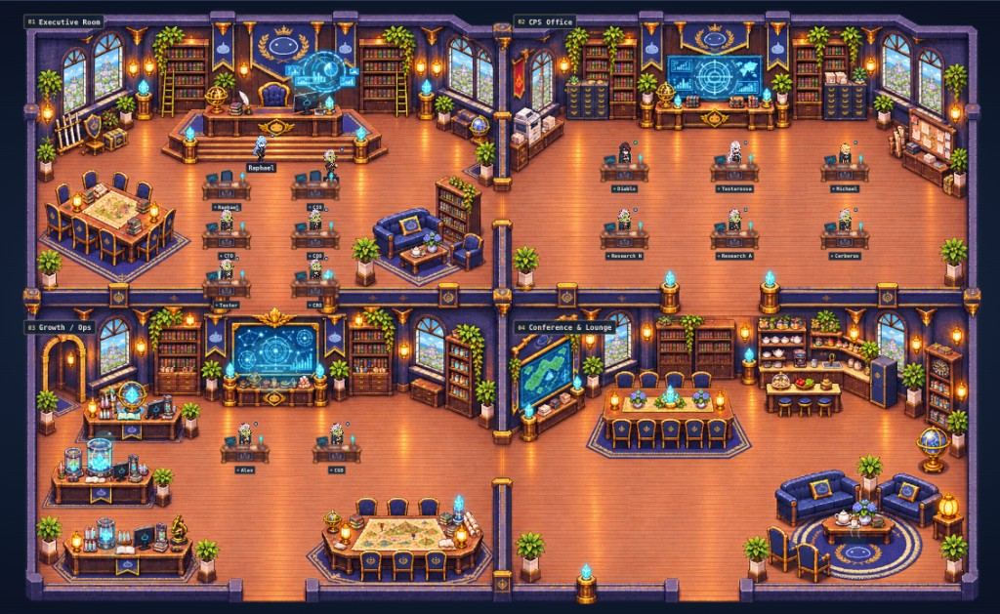
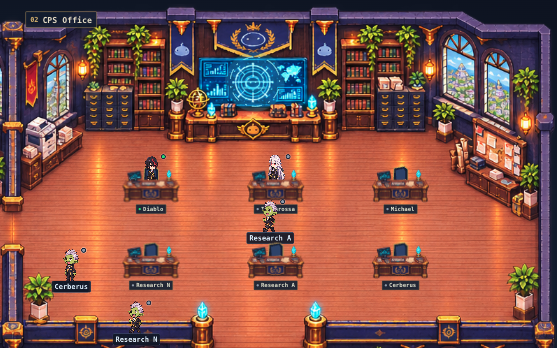
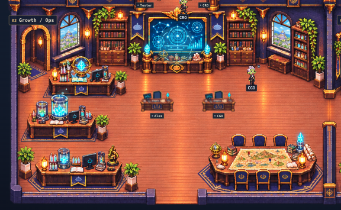
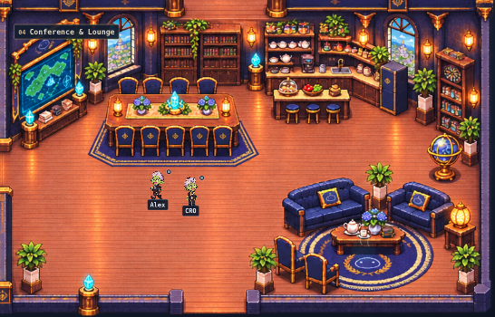
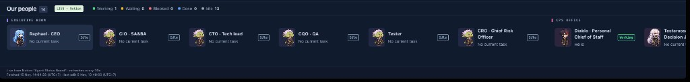
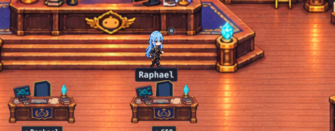
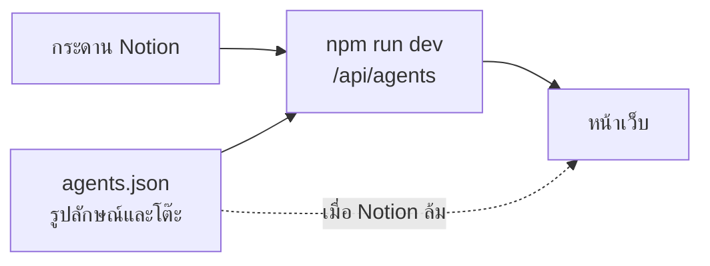

# Pixel Office

สำนักงานเสมือนธีม Tensura ดูสถานะเอเจนต์จากกระดาน Notion แล้วให้แต่ละคนเดินอยู่ในออฟฟิศสี่ห้อง

โปรเจกต์นี้ทำด้วยการ vibe code ผ่าน Codex

**English.** A Tensura-themed office map. Live status comes from a Notion board, because this page cannot open each Grok session the way Claude Code can open its own. `npm run dev` serves the page and the Notion API together. This project was vibe-coded with Codex.

## ทำไมถึงทำ

อยากเห็นว่าแต่ละบอทกำลังทำอะไร โดยไม่ต้องเปิดเซสชันทีละอัน

Claude Code มีรายการเซสชันในเครื่อง เปิดดูและกลับเข้าไปต่อได้ด้วย `claude --resume` Grok CLI ก็บันทึกเซสชันในเครื่องเหมือนกัน และมี `grok sessions list` ให้ดูบนเครื่องที่รัน Grok แต่หน้านี้อยู่นอกโปรแกรมนั้น ไม่มี API สาธารณะของ xAI ให้เปิดรายการแชตของ Grok ทีละเซสชัน บอทจึงไปยืนยันสถานะลงกระดาน Notion แล้วออฟฟิศนี้เอาสถานะนั้นมาแสดงเป็นคนในห้อง



ภาพรวมทั้งออฟฟิศ มุมบนซ้ายคือ Executive Room มีโต๊ะผู้บริหารและที่ทำงานของ Raphael กับทีม มุมบนขวาคือ CPS Office มีจอเรดาร์และโต๊ะของ Diablo, Testarossa, Michael มุมล่างซ้ายคือ Growth / Ops มีโต๊ะทดลองกับจอแผนที่ มุมล่างขวาคือ Conference & Lounge มีโต๊ะประชุม ครัว และโซฟา ประตูตรงกลางเชื่อมทั้งสี่ห้อง คนในภาพเดินไปมาได้ จึงไม่จำเป็นต้องยืนอยู่ที่โต๊ะของตัวเอง

## เปิดใช้งาน

ต้องมี Node.js 20 ขึ้นไป

```bash
npm install
npm run dev
```

เปิด http://localhost:5173

คำสั่งนี้เปิดทั้งหน้าเว็บและเส้นดึง Notion ไม่ต้องเปิดเซิร์ฟเวอร์อีกตัว ถ้ายังไม่ได้ตั้งค่า Notion หน้าเว็บเปิดได้ แต่ป้ายจะขึ้น **SAMPLE DATA (offline)**

วิธีเปิดบน iPad อยู่ใน [RUNNING.md](RUNNING.md)

## ตั้งค่า Notion

สถานะสดมาจากฐานข้อมูลชื่อ **Agent Status Board** ใต้หน้า SERVER NEXUS เบราว์เซอร์ไม่ได้คุยกับ Notion ตรง ๆ ตัว `npm run dev` อ่านโทเคนจาก `.env.local` แล้วเรียก API ให้

1. สร้าง internal integration ชื่อ `pixel-office` ที่ [หน้า Connections ของ Notion](https://www.notion.so/profile/integrations) เลือกเวิร์กสเปซที่มีกระดานนี้ และเปิดสิทธิ์อ่านเนื้อหา
2. คัดลอก secret token โทเคนนี้เห็นได้ครั้งเดียวตอนสร้าง ห้ามส่งให้ใคร ห้าม commit และห้ามใส่ในตัวแปรที่ขึ้นต้นด้วย `VITE_`
3. เปิดฐานข้อมูล Agent Status Board เป็นหน้าเต็ม เลือกเมนู `•••` แล้วเลือก **Add connections** เพิ่ม integration `pixel-office` โทเคนอย่างเดียวเข้ากระดานไม่ได้ ต้องแชร์หน้านี้ให้ integration ด้วย
4. คัดลอก database ID จาก URL ของหน้าเต็ม ช่วงเลข 32 ตัวหลังชื่อเวิร์กสเปซ ใส่ขีดเป็นรูปแบบ `8-4-4-4-12` กระดานของโปรเจกต์นี้คือ `0485c7b4-b530-480f-80b1-85e449ba42c7`
5. สร้างไฟล์ `.env.local` ที่รากโปรเจกต์ Git ข้ามไฟล์ `*.local` อยู่แล้ว

```bash
NOTION_TOKEN=secret_หรือ_ntn_ที่คัดลอกมา
NOTION_DATABASE_ID=0485c7b4-b530-480f-80b1-85e449ba42c7
```

6. หยุดแล้วรัน `npm run dev` ใหม่ เปิด http://localhost:5173 ป้ายต้องขึ้น **LIVE · Notion** ตรวจคำตอบได้ด้วย `curl http://localhost:5173/api/agents` ถ้าตั้งค่าผิด เส้นนี้ตอบ HTTP 502

แก้สถานะใน Notion แล้วรอประมาณ 30–45 วินาที หน้าเว็บจะเปลี่ยนเอง เซิร์ฟเวอร์เก็บผลไว้ประมาณ 15 วินาที หน้าเว็บดึงซ้ำทุก 30 วินาที

ช่องในฐานข้อมูลต้องชื่อตรงนี้ ชนิดช่องตรงนี้ ไม่งั้นแถวนั้นจะไม่ถูกอ่าน

| ช่อง | ชนิดใน Notion | ใช้อย่างไร |
| --- | --- | --- |
| Agent | Title | ชื่อบนการ์ด เช่น `Raphael · CEO` |
| Agent ID | Text | ตรงกับ `agentId` ใน `src/data/agents.json` ใช้จับคู่โต๊ะและรูปลักษณ์ |
| Status | Select | `idle`, `working`, `waiting`, `done`, `blocked` |
| Room | Select | `Executive`, `CPS`, `Growth` หรือ `Growth/Ops` |
| Current Task | Text | ข้อความบนการ์ด ว่างแล้วหน้าเว็บใส่ข้อความตามสถานะให้ |
| Updated | Last edited time | ไม่ต้องสร้างก็ได้ โค้ดใช้เวลาแก้ไขล่าสุดของแถว |

คนที่ยังไม่มีแถวใน `agents.json` ยังแสดงได้ แต่จะไม่มีโต๊ะและรูปลักษณ์เดิม ไปต่อท้ายรายการ ถ้าโทเคนหลุด ให้ลบหรือสร้างใหม่ที่ [หน้า Connections](https://www.notion.so/profile/integrations) แล้วแก้ `.env.local` ก่อนรันใหม่

## ในออฟฟิศมีอะไร

สี่ห้องต่อกันบนพื้นเดียวกัน ซูมเข้าแล้วเลื่อนดูได้ ประตูเชื่อมห้องถึงกัน

| ห้อง | ใครอยู่ |
| --- | --- |
| Executive Room | Raphael, CIO, CTO, CQO, Tester, CRO |
| CPS Office | Diablo, Testarossa, Michael, Research, Cerberus |
| Growth / Ops | Alex, CGO |
| Conference & Lounge | ห้องประชุมและเลานจ์ ไม่มีโต๊ะทำงานประจำ |



CPS Office ซูมเข้า ผนังด้านในมีจอเรดาร์ โต๊ะเรียงสามตัวเป็นของ Diablo, Testarossa และ Michael แถวหน้าเป็น Research N, Research A และ Cerberus ผมขาวตรงกลางคือ Testarossa ผมดำทางซ้ายคือ Diablo ที่เหลือเป็นก็อบลิน Tempest



Growth / Ops ซูมเข้า ด้านซ้ายเป็นโต๊ะทดลองและโถคริสตัล ตรงกลางเป็นจอแผนที่ โต๊ะทำงานป้าย Alex กับ CGO อยู่ในภาพนี้ Tester กับ CRO มายืนที่จอ และ CGO ยืนทางขวา ทั้งสามเดินออกจากห้องของตัวเองได้เพราะประตูเชื่อมถึงกัน



Conference & Lounge ไม่มีโต๊ะทำงานประจำ ด้านซ้ายเป็นโต๊ะประชุมยาว ด้านขวาเป็นครัวและชั้นหนังสือ ด้านล่างเป็นโซฟาน้ำเงินกับโต๊ะน้ำชา Alex กับ CRO ในภาพเดินมาที่นี่จากห้องอื่น กด Visit lounge แล้วคนที่เลือกจะเดินมาโซนนี้



แถบ Our people อยู่ขอบล่างของหน้าจอ เลื่อนในแนวนอน การ์ดจัดกลุ่มตามห้อง แต่ละใบมีรูปคน ชื่อ งานปัจจุบัน และป้ายสถานะ ป้าย LIVE · Notion แปลว่าข้อมูลชุดนี้มาจากกระดาน Notion ในภาพ Diablo สถานะ Working และงานคือ Hello คนที่ช่องงานว่างจะขึ้น No current task เลือกการ์ดแล้วตัวละครบนแผนที่ถูกเลือกตาม



Raphael ซูมใกล้ใน Executive Room ป้ายชื่อลอยเหนือตัว ผมฟ้ายาวชุดดำขอบทองเป็นรูปลักษณ์เฉพาะของ Raphael โต๊ะด้านล่างยังป้ายชื่อเจ้าของไว้ แม้เจ้าของจะเดินออกมาแล้ว Diablo, Testarossa และ Michael ก็มีรูปลักษณ์เฉพาะแบบนี้ คนที่เหลือใช้ก็อบลิน Tempest รูปในการ์ดกับตัวบนแผนที่เป็นสไปรต์ชุดเดียวกัน

## วิธีใช้

1. เลือกคนจากการ์ดหรือจากตัวละครบนแผนที่
2. คลิกจุดพื้นเรืองแสงเพื่อให้เดินไปจุดนั้น
3. **Visit lounge** ส่งคนที่เลือกไปเลานจ์ **Return to desk** หรือคลิกคอมพิวเตอร์ของคนนั้นเพื่อเดินกลับโต๊ะ
4. **Pause** หยุดการเดินและเอฟเฟกต์บนโต๊ะ

คนสถานะ working พิมพ์งานที่โต๊ะของตัวเอง คนสถานะ idle เดินเตร่ข้ามห้อง

การเดินเปลี่ยนแค่ภาพบนจอ ไม่ได้สั่งงานเอเจนต์ และไม่ได้แก้ข้อมูลใน Notion

## สถานะ

สีบนแถบรายชื่อตรงกับจุดบนแผนที่

| สถานะ | สี | ความหมาย |
| --- | --- | --- |
| `working` | เขียว | กำลังทำงาน อยู่ที่โต๊ะ |
| `waiting` | เหลือง | รอการตัดสินใจ |
| `blocked` | แดง | ติดขัด ต้องการความช่วยเหลือ |
| `done` | น้ำเงิน | ทำเสร็จแล้ว |
| `idle` | เทา | ว่าง เดินเตร่ในออฟฟิศ |

ป้าย **LIVE · Notion** แปลว่าสถานะมาจากกระดาน Notion ป้าย **SAMPLE DATA (offline)** แปลว่าดึง Notion ไม่ได้ เลยใช้ `src/data/agents.json` หน้าเว็บลองใหม่ทุก 30 วินาที

ช่อง Current Task ว่างจะขึ้นข้อความ "No current task" แม้สถานะจะมาจาก Notion

## ข้อมูลเดินทางยังไง



เบราว์เซอร์ไม่เห็นโทเคน Notion โทเคนอยู่ใน `.env.local` ฝั่งเซิร์ฟเวอร์ แถวใน Notion จับคู่กับตัวละครด้วย Agent ID ก่อน แล้วจึงใช้ชื่อ เพื่อให้โต๊ะและรูปลักษณ์ตรงคนเดิม

`npm run build` สร้างไฟล์ไว้ใน `dist/` แล้ว `npm run preview` ยังดึง Notion ได้เหมือนตอนพัฒนา ถ้าเอา `dist/` ไปเปิดกับเว็บเซิร์ฟเวอร์อื่น จะไม่มีเส้น `/api/agents` สถานะจึงเป็นข้อมูลตัวอย่าง

## สำหรับคนแก้โค้ด

หน้าเว็บเป็น Vite + React + TypeScript ห้องเป็นภาพ PNG ตัวละครวาดบน Canvas ฉาก PixiJS รุ่นก่อนอยู่ใน `src/game/scene.ts` แต่หน้าเว็บที่เปิดอยู่ไม่ได้ใช้

| ไฟล์ | ทำอะไร |
| --- | --- |
| `src/App.tsx` | ดึง `/api/agents` ทุก 30 วินาที และจำว่าเลือกใคร |
| `src/components/TensuraOffice.tsx` | แผนที่ โต๊ะ และการเดิน |
| `src/components/SidePanel.tsx` | แถบ Our people |
| `src/game/campus.ts` | ตำแหน่งห้อง ประตู และจุดเดิน |
| `server/notion-agents.ts` | อ่าน Notion ตอน `dev` และ `preview` เก็บผลไว้ประมาณ 15 วินาที |
| `src/data/agents.json` | ข้อมูลตัวอย่าง และรายการจับคู่แถวจาก Notion |

แนวทางแก้หน้าจออยู่ใน [SKILL.md](SKILL.md) ทิศทางภาพอยู่ใน [THEME.md](THEME.md)

```bash
npm test       # ตรวจการเดินและการนำทาง
npm run build  # ตรวจว่าโปรเจกต์คอมไพล์ผ่าน
```

## แหล่งอ้างอิง

- [สร้าง integration และแชร์หน้าให้ connection](https://www.notion.com/help/create-integrations-with-the-notion-api) เป็นขั้นตอนในข้อ 1 และ 3
- [Internal connections และที่คัดลอกโทเคน](https://developers.notion.com/guides/connections-and-tokens/internal-connections) โปรเจกต์ใช้แบบ internal ไม่ใช่ OAuth
- [Query a database](https://developers.notion.com/reference/post-database-query) เป็นเส้นที่ `server/notion-agents.ts` เรียก คือ `POST /v1/databases/{database_id}/query` ด้วยหัว `Notion-Version: 2022-06-28` เอกสารนี้เป็น API ถึงรุ่นนั้น Notion รุ่น `2025-09-03` แยก database กับ data source แล้ว แต่โปรเจกต์นี้ยังใช้เส้นเดิม
- [เซสชันของ Claude Code](https://code.claude.com/docs/en/sessions) รายการเซสชันในเครื่อง เปิดด้วย `claude --resume`
- [เซสชันของ Grok CLI](https://docs.x.ai/build/features/sessions) รายการเซสชันในเครื่องที่รัน Grok คำสั่ง `grok sessions list` API สาธารณะที่ [docs.x.ai](https://docs.x.ai/developers/rest-api-reference/inference/chat-completions) ไม่มีเส้นดึงรายการแชตนี้
- [Codex](https://learn.chatgpt.com/docs/codex-manual) เครื่องมือที่ใช้ vibe code โปรเจกต์นี้ ใช้งานจากเทอร์มินัลได้ตาม [Codex CLI](https://learn.chatgpt.com/docs/codex/cli)
- [RUNNING.md](RUNNING.md) วิธีรันบนเครื่องนี้และเปิดจาก iPad
- [SKILL.md](SKILL.md) จุดแก้โค้ดของหน้าเว็บ
- [THEME.md](THEME.md) ทิศทางภาพ ห้อง และตัวละคร
